<div align="center">

# Dev Cockpit

**Ta journée de dev, sur un seul écran.**

Reviews, cartes, CI, déploiements, sprint et agents Claude Code : Dev Cockpit rassemble GitHub,
YouTrack, Notion et Sentry dans une app de bureau qui dit d'abord **ce qui t'attend**, puis
**ce qui bloque**.

[](https://github.com/parallel-services/dev-cockpit-dist/releases/latest)


[Installer](#installer) · [Tour des vues](#le-tour-des-vues) · [Ambiances](#trois-ambiances) · [Sécurité](#tes-données-restent-chez-toi) · [Releases](https://github.com/parallel-services/dev-cockpit-dist/releases)

<br>

<picture>
  <source media="(prefers-color-scheme: dark)" srcset="docs/screenshots/aujourdhui-sombre.png">
  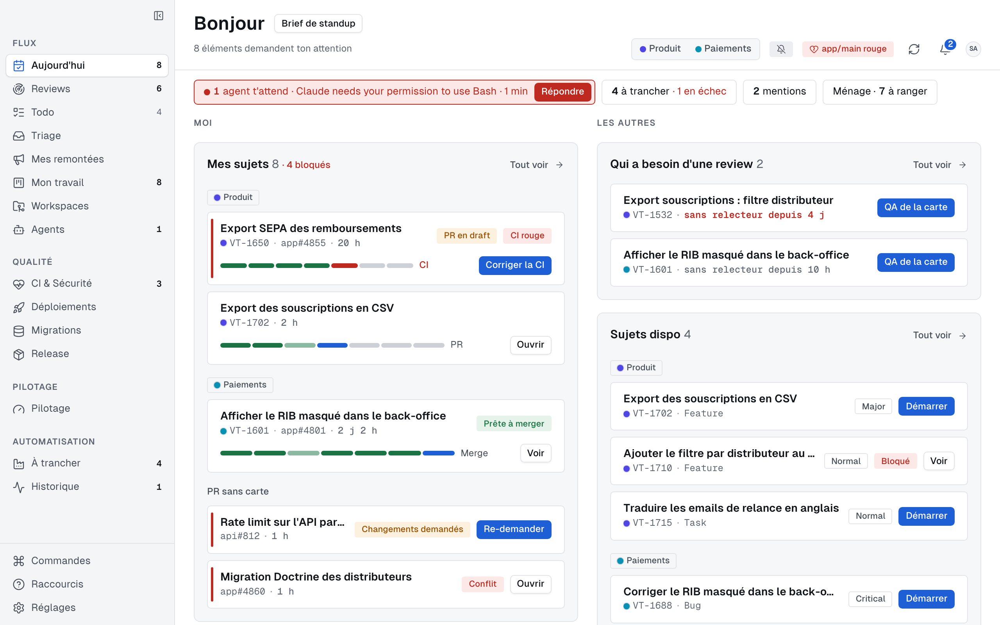
</picture>

</div>

## Installer

```bash
gh api repos/parallel-services/dev-cockpit-dist/contents/install.sh --jq .content | base64 --decode | bash
```

macOS (universel) et Linux. `--beta` pour le canal beta, `--version vX.Y.Z` pour une version
précise, `--deb` sous Linux pour le paquet plutôt que l'AppImage. Ensuite, les mises à jour
arrivent toutes seules, signées.

Au premier lancement, la configuration de l'équipe est déjà là : il ne reste qu'à connecter tes
comptes. Une visite guidée te montre le reste.

## Pourquoi

|  |  |
|---|---|
| 🎯 **Ce qu'on t'a demandé, d'abord** | Une review compte quand on te l'a demandée. Ce qui bouge sans toi devient un signal, rangé à part. |
| 🧭 **Où en est chaque sujet** | Carte → branche → PR → CI → review → merge → recette → prod, sur une seule ligne. |
| 🛑 **Rien n'est écrit sans ton accord** | Chaque écriture (carte, commentaire, PR, message Slack) montre l'aperçu exact avant le clic. |
| 🤖 **Tes agents, sous contrôle** | Sessions Claude Code, workspaces, sorties à trancher : tu vois qui t'attend, et l'agent passe par l'app pour écrire. |
| 🧩 **Seulement ce dont tu as besoin** | 29 modules qui s'allument un par un ; ce qui est éteint disparaît de la barre, des raccourcis et des notifications. |
| ⌨️ **Au clavier** | `j` / `k` pour circuler, `Espace` pour le panneau Sujet, `⌘K` pour tout le reste. |

## Le tour des vues

<table>
  <tr>
    <td width="33%"><a href="#reviews">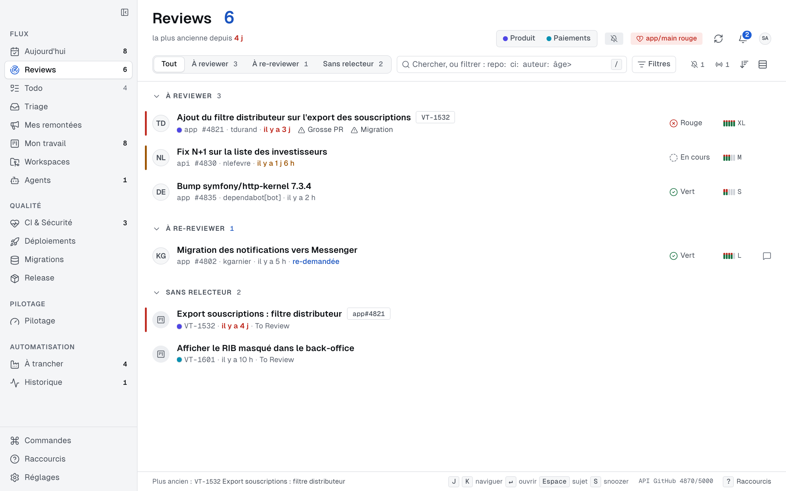</a><br><b>Reviews</b></td>
    <td width="33%"><a href="#mon-travail">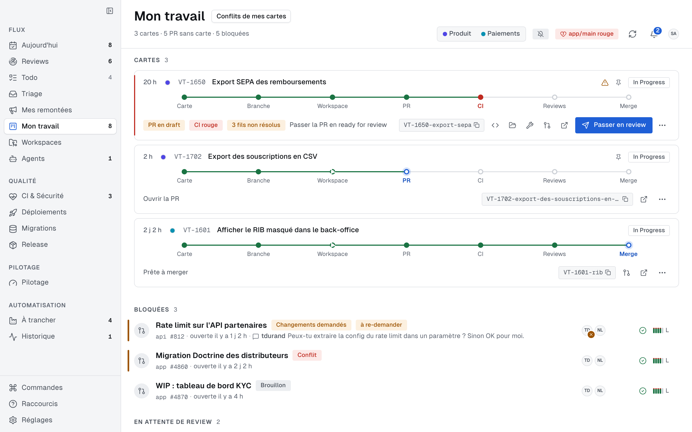</a><br><b>Mon travail</b></td>
    <td width="33%"><a href="#pilotage">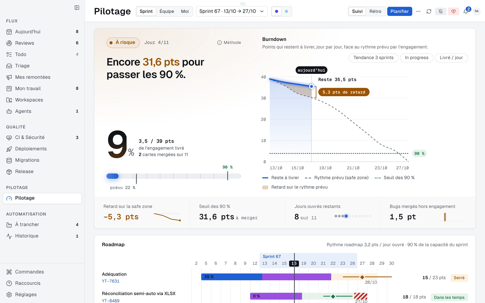</a><br><b>Pilotage</b></td>
  </tr>
  <tr>
    <td><a href="#ci--sécurité">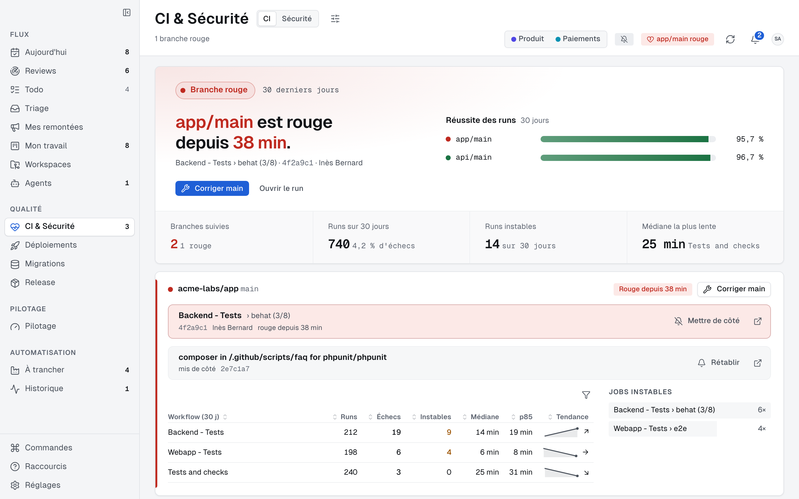</a><br><b>CI & Sécurité</b></td>
    <td><a href="#workspaces">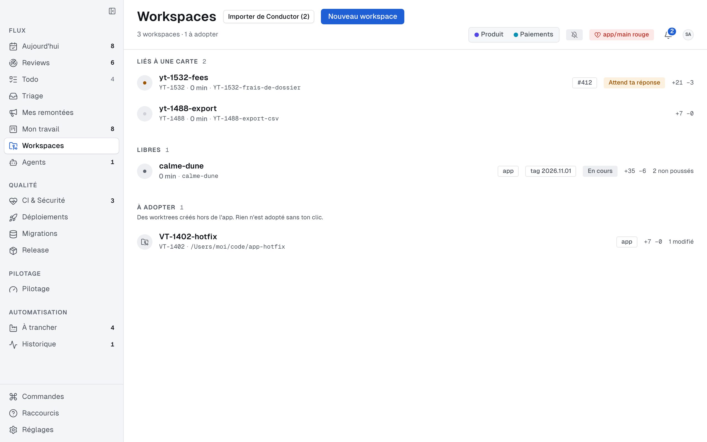</a><br><b>Workspaces</b></td>
    <td><a href="#à-trancher">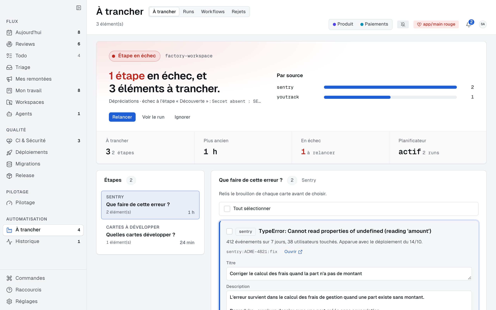</a><br><b>À trancher</b></td>
  </tr>
</table>

La barre range les vues en quatre groupes — **Flux**, **Qualité**, **Pilotage**,
**Automatisation** — et trois vues vivent hors de la barre, ouvertes par la palette. Les captures
viennent du jeu de démonstration, pas d'un vrai compte ; elles suivent le thème clair ou sombre de
ta page GitHub.

---

## Flux

### Aujourd'hui
Ce qui t'attend dans les autres vues, en un coup d'œil : agents, sorties à trancher, mentions,
ménage, puis tes sujets et ceux des autres. Chaque bloc se masque ou se déplace, et un bloc masqué
ne compte nulle part. Le **brief de standup** résume ce qui a bougé depuis le dernier jour ouvré,
prêt à coller dans Slack.

### Reviews
Tout ce qui attend ta review, avec le compteur de la barre de menus. Chaque ligne se lit en deux
temps : le titre, puis son contexte — dépôt, auteur, âge, raison, badges de risque (grosse PR,
migration, fichiers sensibles, sans tests). La recherche comprend des jetons (`repo:app`,
`ci:rouge`, `âge>2j`) avec complétion.

<picture>
  <source media="(prefers-color-scheme: dark)" srcset="docs/screenshots/reviews-sombre.png">
  
</picture>

### Le panneau Sujet
Dans Reviews, Aujourd'hui, Mon travail, Todo et Workspaces, **Espace** ouvre un panneau qui dit où
en est le sujet de la ligne, de la carte à la prod : l'étape en cours mise en avant, une étape
bloquée en rouge, puis les critères d'acceptation, les risques, la CI et la taille. Il ne charge
rien : une étape inconnue est grisée plutôt que devinée.

<picture>
  <source media="(prefers-color-scheme: dark)" srcset="docs/screenshots/panneau-sujet-sombre.png">
  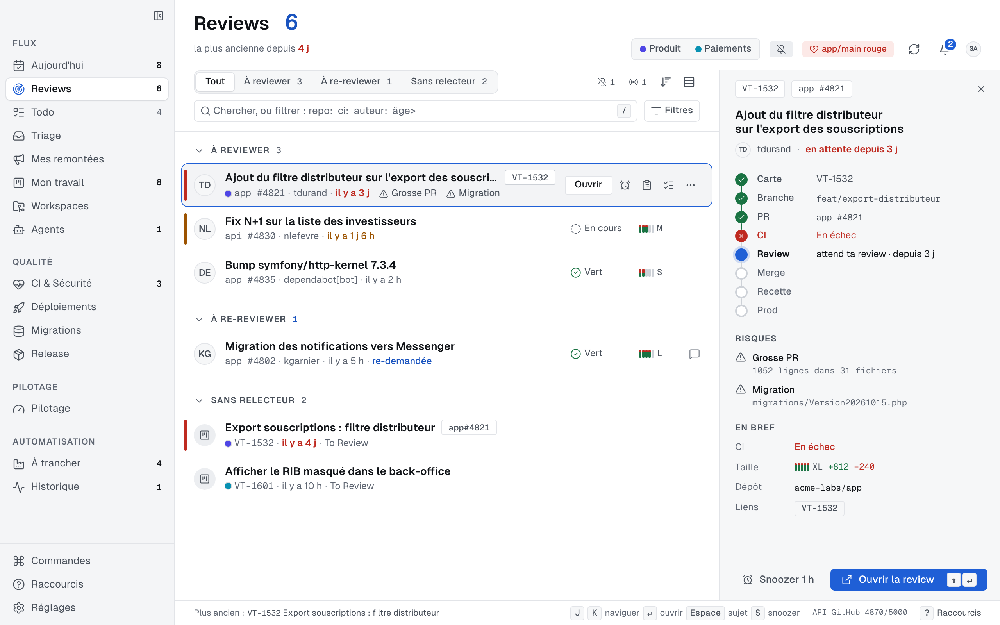
</picture>

### Todo
Les cartes à prendre dans le sprint courant de tes boards, et les workflows qui démarrent le
travail : workspace, terminal, ou départ en hotfix depuis une version de prod.

<picture>
  <source media="(prefers-color-scheme: dark)" srcset="docs/screenshots/todo-sombre.png">
  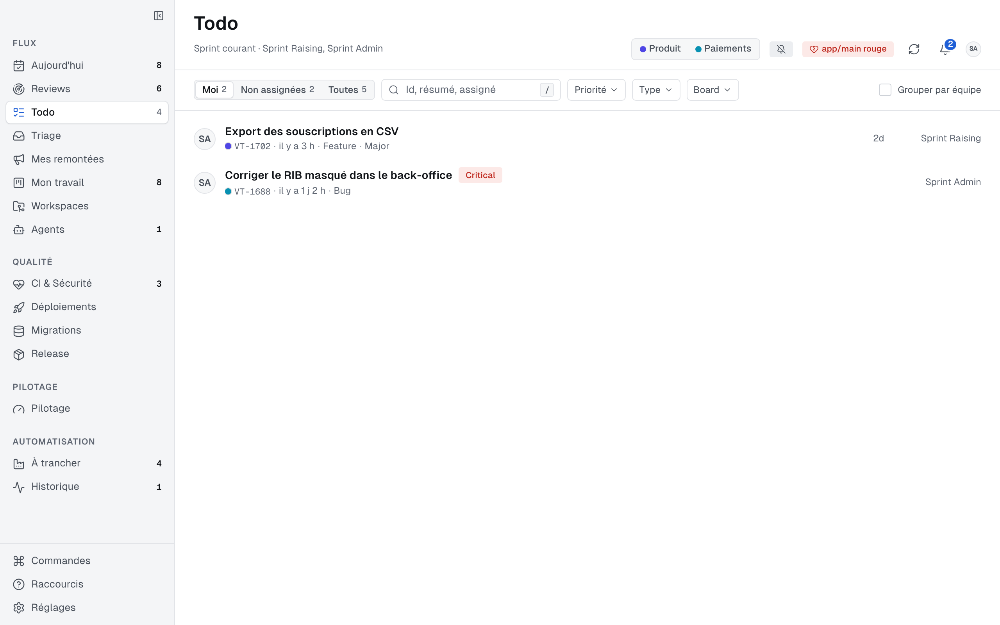
</picture>

### Mon travail
Tes cartes en cours avec leur parcours, puis tes PR sans carte : branche, CI, reviews et conflits.
Ce qui bloque remonte en tête.

<picture>
  <source media="(prefers-color-scheme: dark)" srcset="docs/screenshots/mon-travail-sombre.png">
  
</picture>

### Triage
Les bugs remontés dans Notion et les erreurs Sentry, triés par gravité et transformés en cartes
YouTrack — brouillon et aperçu à l'appui.

<picture>
  <source media="(prefers-color-scheme: dark)" srcset="docs/screenshots/triage-sombre.png">
  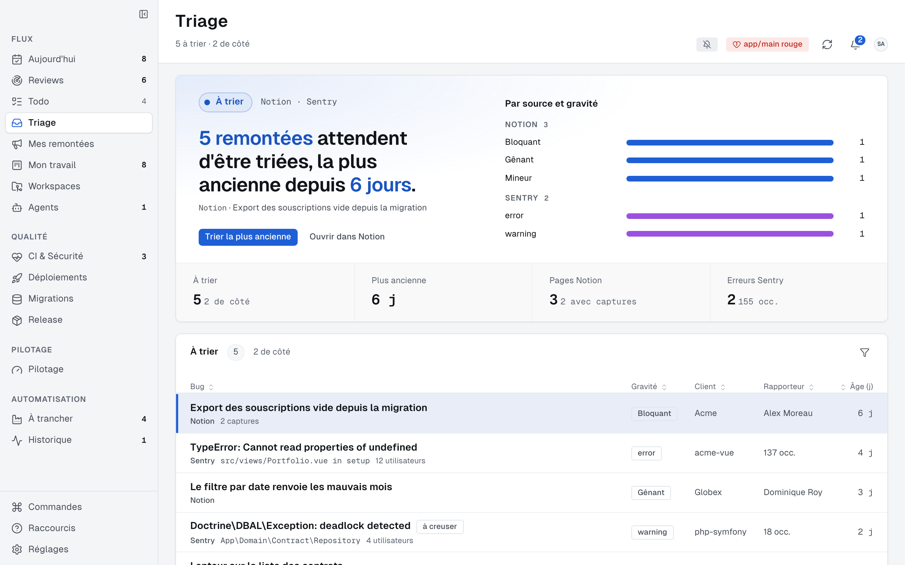
</picture>

### Mes remontées
Les bugs que tu as remontés dans Notion, et ce qu'ils deviennent : ce qui attend ta réponse
d'abord.

<picture>
  <source media="(prefers-color-scheme: dark)" srcset="docs/screenshots/mes-remontees-sombre.png">
  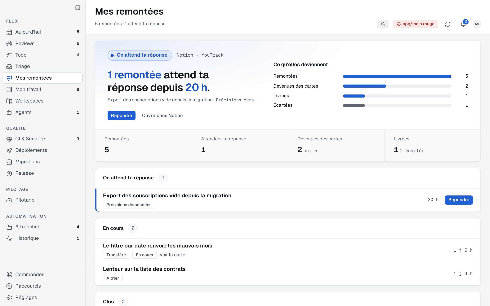
</picture>

### Workspaces
Un worktree git par sujet, où Claude Code travaille : créer, suivre, relire le diff, commiter et
pousser, sans quitter l'app.

<picture>
  <source media="(prefers-color-scheme: dark)" srcset="docs/screenshots/workspaces-sombre.png">
  
</picture>

### Agents
Tes sessions Claude Code ; celles qui attendent une réponse passent devant. Le prompt et les
réponses ne sont jamais lus : l'app ne suit que l'état.

<picture>
  <source media="(prefers-color-scheme: dark)" srcset="docs/screenshots/agents-sombre.png">
  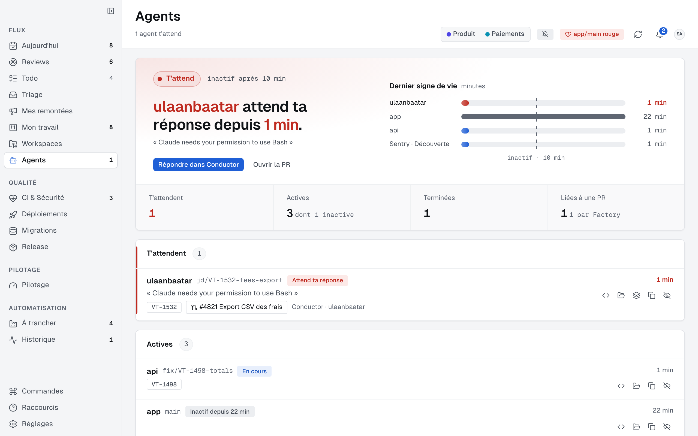
</picture>

## Qualité

### CI & Sécurité
La santé de ce qui part en production : branche principale rouge, jobs instables et durées des
workflows d'un côté ; alertes Dependabot, code scanning et secret scanning de l'autre. Un correctif
se lance d'un clic, dans un workspace ou le terminal.

<picture>
  <source media="(prefers-color-scheme: dark)" srcset="docs/screenshots/ci-securite-sombre.png">
  
</picture>

### Déploiements
Les PR mergées, environnement par environnement : en recette, en prod ou pas encore déployées. Les
notes de version du prochain déploiement se calculent toutes seules.

<picture>
  <source media="(prefers-color-scheme: dark)" srcset="docs/screenshots/deploiements-sombre.png">
  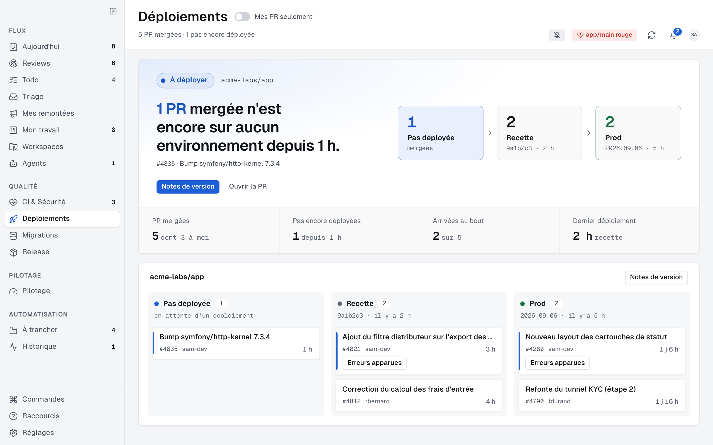
</picture>

### Migrations
Les PR ouvertes qui touchent une migration : qui doit la relire, depuis combien de jours ouvrés, et
le SQL qu'elle joue.

<picture>
  <source media="(prefers-color-scheme: dark)" srcset="docs/screenshots/migrations-sombre.png">
  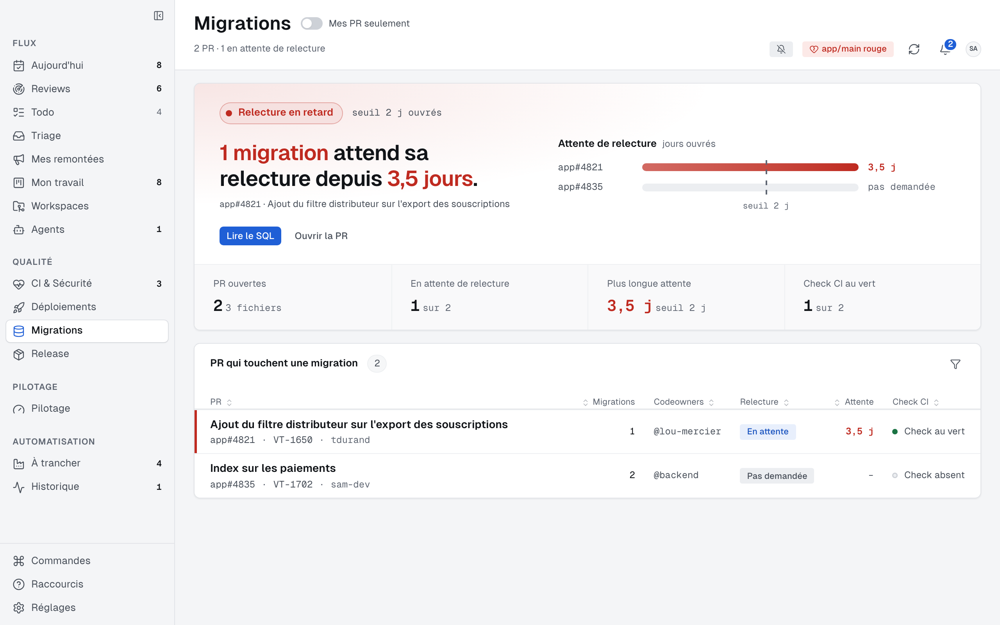
</picture>

### Release
Préparer une version : le tag suivant, le commit cible, les traductions en attente et le changelog
que les cartes ont écrit. La vue prépare ; elle ne publie rien.

<picture>
  <source media="(prefers-color-scheme: dark)" srcset="docs/screenshots/release-sombre.png">
  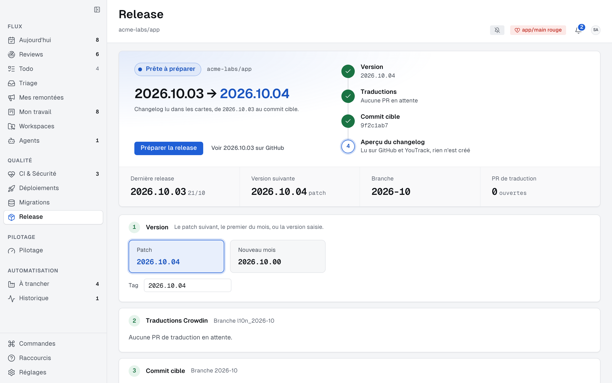
</picture>

## Pilotage

Un seul écran, trois onglets, calculés sur ta machine à partir d'une copie locale de l'historique.

### Sprint
Le burndown du sprint, sa rétro, et l'image prête à poster dans Slack. Les courbes de réalisé
s'arrêtent à aujourd'hui ; la safe zone continue jusqu'au bout.

<picture>
  <source media="(prefers-color-scheme: dark)" srcset="docs/screenshots/pilotage-sprint-sombre.png">
  
</picture>

Dessous, la **roadmap** de l'équipe en Gantt : chaque sujet Notion avec ce qui est livré, en cours
ou bloqué dans ses épics, sa fin projetée au rythme de l'équipe et le risque de rater la deadline.

<picture>
  <source media="(prefers-color-scheme: dark)" srcset="docs/screenshots/roadmap-sombre.png">
  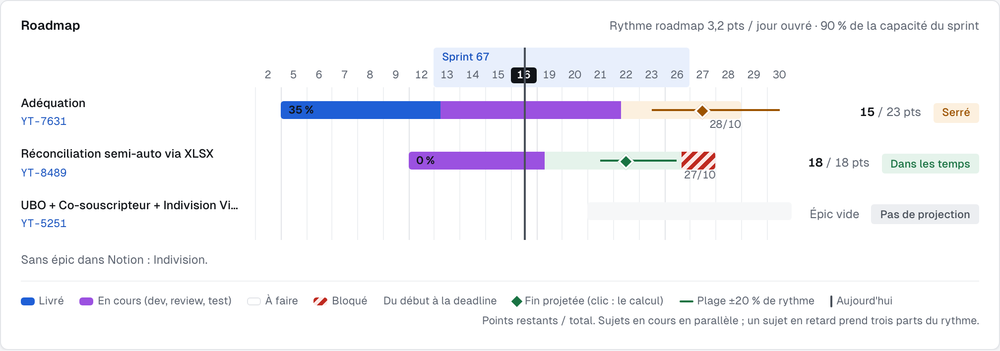
</picture>

### Équipe
Les KPI de fabrication : débit, durées et fluidité, par sprint, par équipe et par période.

<picture>
  <source media="(prefers-color-scheme: dark)" srcset="docs/screenshots/pilotage-equipe-sombre.png">
  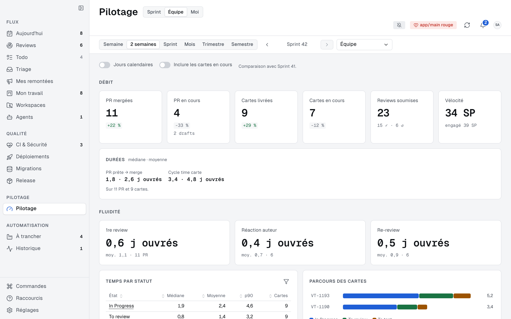
</picture>

### Moi
Tes propres chiffres face à ceux de l'équipe. Rien n'est envoyé nulle part : la comparaison se
fait sur ta machine, à partir des médianes.

<picture>
  <source media="(prefers-color-scheme: dark)" srcset="docs/screenshots/pilotage-moi-sombre.png">
  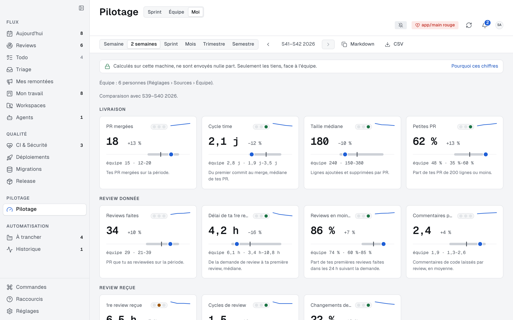
</picture>

## Automatisation

### À trancher
Des workflows planifiés font chercher par des agents ce qui mérite une action et préparer
l'écriture complète. Tu acceptes, modifies, rejettes ou reportes ; l'étape suivante écrit
exactement ce que tu as accepté, et un rejet ne revient pas.

<picture>
  <source media="(prefers-color-scheme: dark)" srcset="docs/screenshots/a-trancher-sombre.png">
  
</picture>

### Historique
Les enchaînements, actions, runs et appels MCP passés, étape par étape : ce qui a été écrit, ce qui
a échoué, et où reprendre.

<picture>
  <source media="(prefers-color-scheme: dark)" srcset="docs/screenshots/historique-sombre.png">
  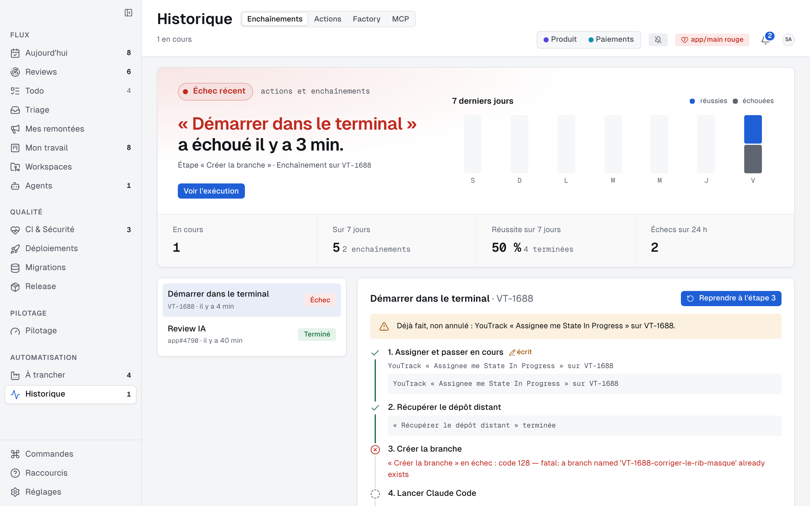
</picture>

### Claude Code branché sur l'app
Le serveur MCP de Dev Cockpit est actif par défaut et s'ajoute à Claude Code d'un clic : chaque
fonctionnalité de l'app devient un outil, et un agent lit tes reviews, tes cartes ou ton sprint
comme toi. Les écritures sont éteintes tant que tu ne les allumes pas, et chacune passe par une
demande que tu valides dans l'app, aperçu exact à l'appui.

## Hors de la barre

Trois vues que la palette (`⌘K`) ouvre, et qui se signalent d'elles-mêmes quand elles ont quelque
chose à dire.

<table>
  <tr>
    <td width="33%"><b>Ménage</b><br>Branches fusionnées, worktrees, images et volumes à ranger, avec la place qu'ils libèrent. Rien n'est supprimé sans aperçu.</td>
    <td width="33%"><b>Notes</b><br>Une note en deux secondes avec <code>⌘⇧Espace</code> depuis n'importe où, triée ici et convertie en carte quand elle le mérite.</td>
    <td width="33%"><b>Absence</b><br>Avant de partir : reviews confiées, cartes en cours, passation écrite, notifications en sourdine jusqu'au retour.</td>
  </tr>
  <tr>
    <td><picture><source media="(prefers-color-scheme: dark)" srcset="docs/screenshots/menage-sombre.png">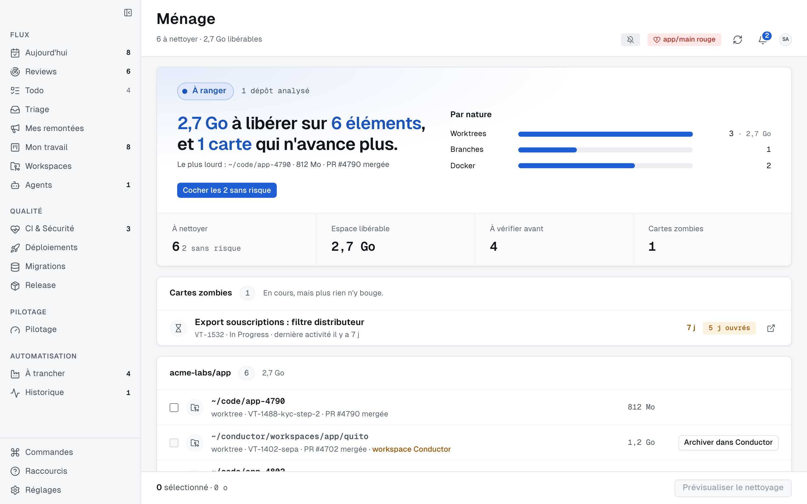</picture></td>
    <td><picture><source media="(prefers-color-scheme: dark)" srcset="docs/screenshots/notes-sombre.png">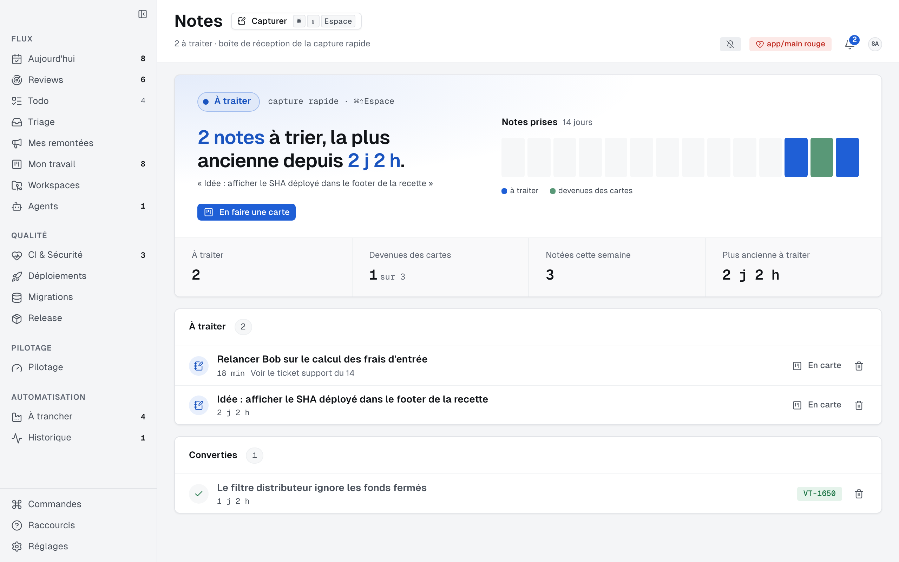</picture></td>
    <td><picture><source media="(prefers-color-scheme: dark)" srcset="docs/screenshots/absence-sombre.png">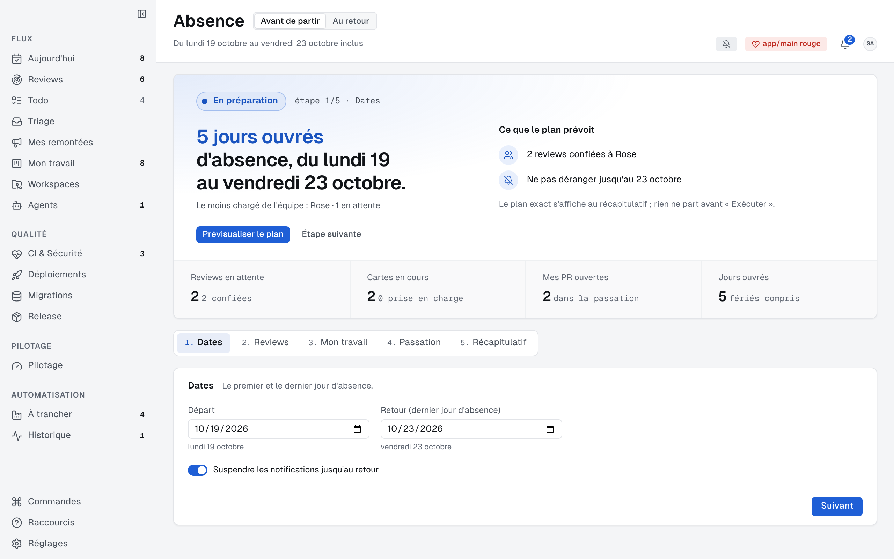</picture></td>
  </tr>
</table>

## Composer son cockpit

Les modules s'activent un par un, avec leurs dépendances et des profils tout faits (Review, Dev,
Lead, Produit, Ops). Les comptes se connectent dans les réglages ; les notifications se taisent pendant tes
réunions et gardent les reviews pour les créneaux que tu as choisis.

<table>
  <tr>
    <td width="33%"><picture><source media="(prefers-color-scheme: dark)" srcset="docs/screenshots/modules-sombre.png">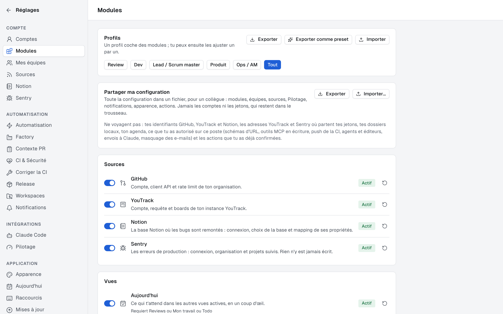</picture><br><b>Modules</b></td>
    <td width="33%"><picture><source media="(prefers-color-scheme: dark)" srcset="docs/screenshots/comptes-sombre.png">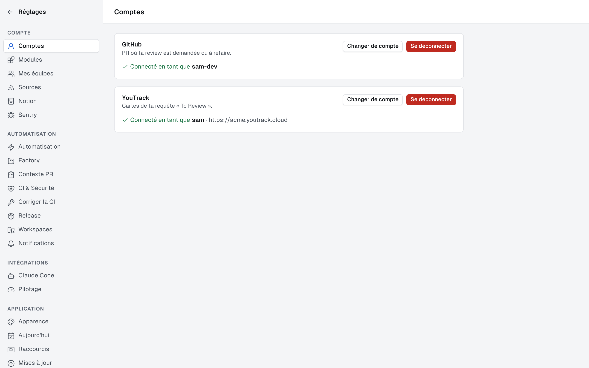</picture><br><b>Comptes</b></td>
    <td width="33%"><picture><source media="(prefers-color-scheme: dark)" srcset="docs/screenshots/notifications-sombre.png">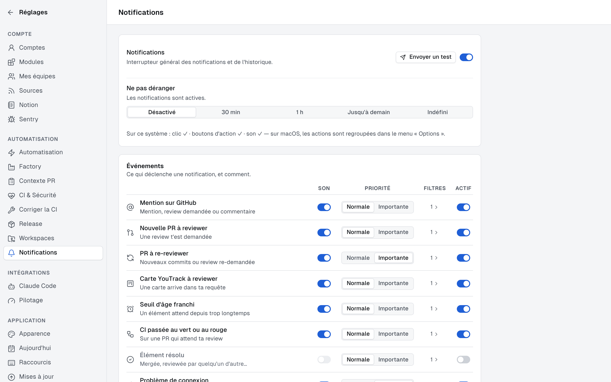</picture><br><b>Notifications</b></td>
  </tr>
</table>

## Trois ambiances

Une ambiance règle la peau de l'app — matière des surfaces, profondeur, typographie, mouvement —
sans toucher aux vues ni à la densité des listes. Chacune a sa variante claire et sombre, et un
thème est **refusé s'il ne se lit pas** : chaque paire texte/fond tient le contraste AA de 4,5:1.

<table>
  <tr>
    <td width="33%">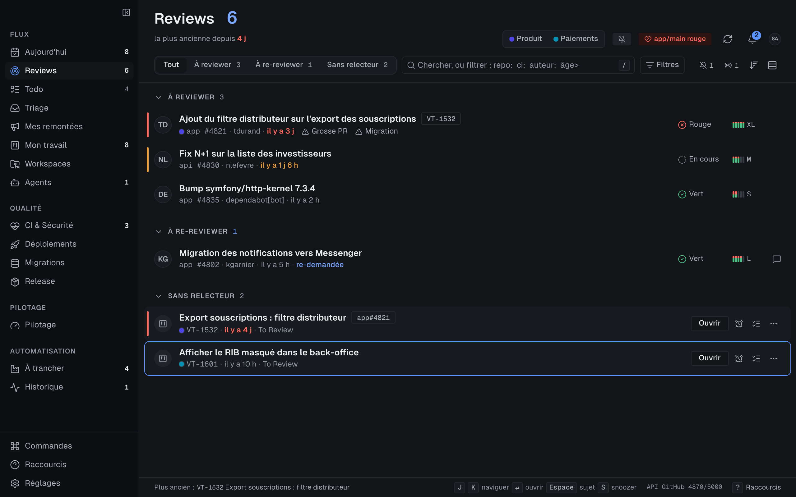<br><b>Précision</b> — le défaut : monochrome froid, un seul accent bleu.</td>
    <td width="33%">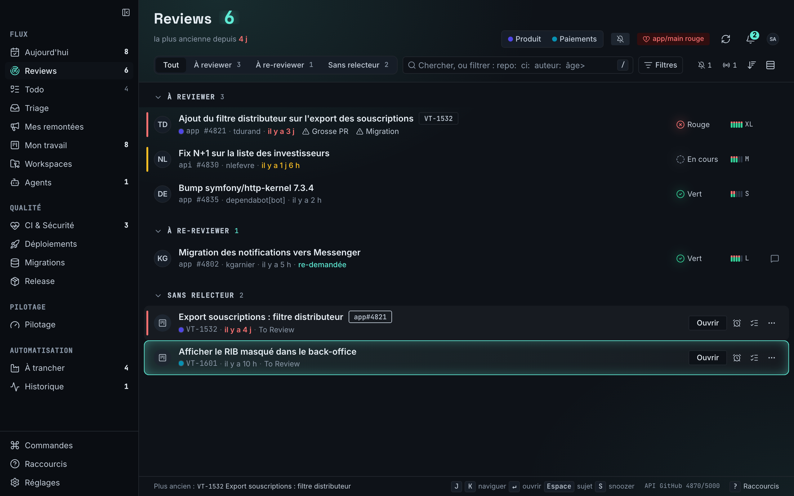<br><b>Cockpit</b> — poste de pilotage sombre, accent teal, halos d'accent.</td>
    <td width="33%">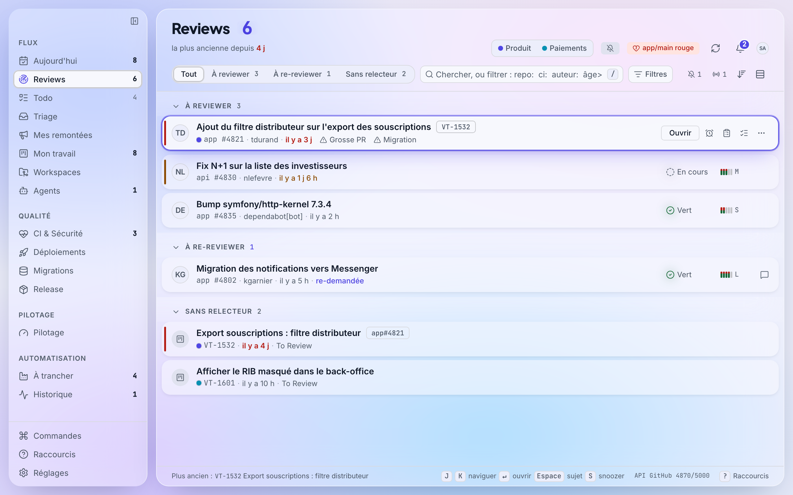<br><b>Verre</b> — panneaux translucides sur un fond en dégradés.</td>
  </tr>
</table>

<picture>
  <source media="(prefers-color-scheme: dark)" srcset="docs/screenshots/ambiances-sombre.png">
  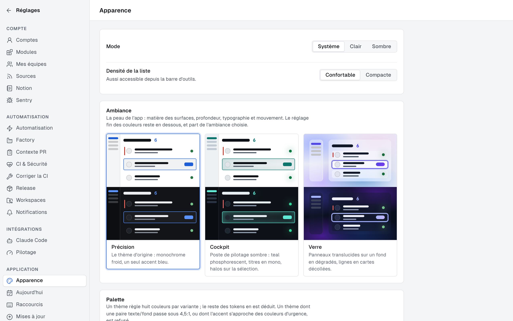
</picture>

## Visite guidée

Au premier lancement, un pas à pas éclaire l'app zone par zone, puis propose un tour des modules
que tu as allumés — jamais d'une fonction que tu n'as pas. `⌘K` › « Visite guidée » la relance.

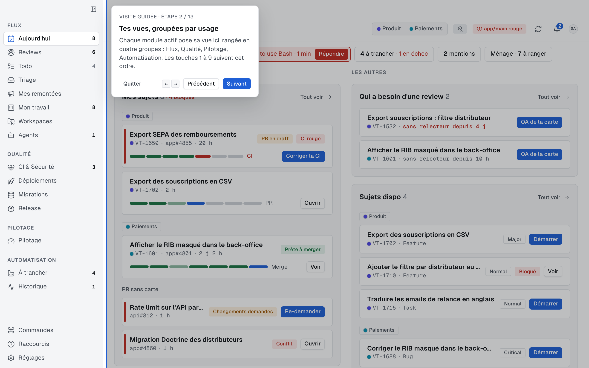

## Tes données restent chez toi

- **Pas de serveur, pas de compte** : une app par personne, qui parle directement à GitHub,
  YouTrack, Notion et Sentry.
- **Jetons dans le trousseau** du système, jamais dans un fichier ; tout le réseau part du back
  Rust, rien du front.
- **Tout ce qui sort est masqué** — logs, diagnostic, rapport de bug, réponses aux agents.
- **Aucune écriture sans aperçu exact** et confirmation, que le clic vienne de toi ou d'un agent.

## Ce que porte une release

| Fichier | Pour |
|---|---|
| `Dev.Cockpit_<version>_universal.app.tar.gz` + `.sig` | macOS, c'est ce que l'updater installe |
| `Dev.Cockpit_<version>_universal.dmg` | macOS, première installation à la main |
| `Dev.Cockpit_<version>_amd64.AppImage` + `.sig` | Linux, mise à jour automatique |
| `Dev.Cockpit_<version>_amd64.deb` + `.sig` | Linux, paquet (root, mises à jour manuelles) |
| `latest.json` | le manifeste que l'app lit : version, notes, signature par plateforme |

Chaque artefact est signé (minisign) : l'app vérifie la signature avec sa clé publique intégrée et
refuse toute mise à jour qui ne correspond pas. La release fixe `remote-config` porte la
configuration distante signée, relue toutes les heures.

Ce dépôt ne porte que les binaires, leur manifeste et ces captures : l'app n'a besoin d'aucun accès
au dépôt de code pour se mettre à jour.
